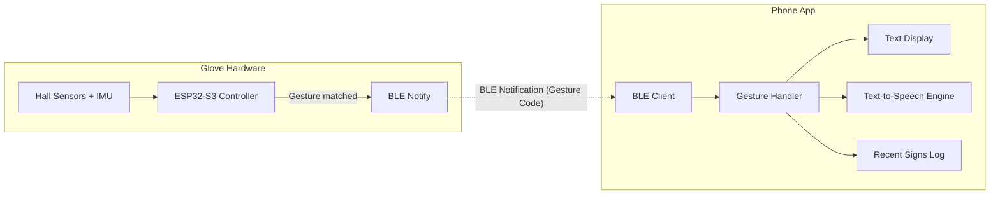

# Product Requirements Document
## ISL Glove Companion App — Software

**Version:** 1.0
**Component:** Mobile Application (paired with Non-Contact ISL Gesture-Recognition Glove)
**Status:** Draft for development

---

## 1. Overview

The ISL Glove Companion App is the software half of a non-contact Indian Sign Language (ISL) gesture-recognition system. The hardware glove (ESP32-S3 + Hall-effect sensors + IMU) senses hand gestures and transmits recognized signs over Bluetooth Low Energy (BLE). This app receives that data, converts it into readable text, and speaks it aloud — turning a physical hand gesture into audible, spoken language in real time.

**Core value proposition:** Enable a non-verbal ISL user to communicate with someone who doesn't know sign language, without needing an interpreter present.

---

## 2. Goals

- Reliable, low-latency BLE connection to the glove
- Real-time display of recognized signs as text
- Real-time text-to-speech output of recognized signs
- Stable performance across a full conversation session (not just single-gesture demos)
- Simple enough that a first-time user (the ISL signer, not a technical person) can operate it unaided

### Non-Goals (for this version)
- No user accounts / login / cloud backend
- No support for multiple glove pairing (one phone ↔ one glove at a time)
- No offline gesture-model retraining from within the app (calibration only, not full retraining)

---

## 3. User Personas

**Primary user — the Signer:** A person who communicates in ISL, wearing the glove, who needs their gestures translated into spoken/written language for someone else to understand.

**Secondary user — the Listener:** The person the signer is communicating with, who reads the on-screen text and/or hears the TTS output. Typically does not interact with the app directly.

---

## 4. Functional Requirements

### 4.1 Must-Have (Core)

| # | Feature | Description |
|---|---------|-------------|
| 1 | BLE Connect/Disconnect | Scan for, connect to, and disconnect from the glove's BLE peripheral. Auto-reconnect on unexpected disconnection. |
| 2 | Live Gesture Display | Show the currently recognized sign as large, high-contrast on-screen text. |
| 3 | Text-to-Speech Output | Automatically speak each recognized sign aloud the moment it's received. |
| 4 | Recent Signs Log | Scrollable list of the last N recognized signs in a session, with timestamps. |
| 5 | Connection Status Indicator | Persistent visual indicator of BLE connection state (Connected / Connecting / Disconnected). |

### 4.2 Should-Have

| # | Feature | Description |
|---|---------|-------------|
| 6 | Per-User Calibration | Guided flow ("make a fist," "spread fingers") to capture each wearer's sensor baseline, sent to the glove or stored/applied on the app side. |
| 7 | TTS Settings | Adjustable speech rate, volume, and voice/language selection. |
| 8 | Confidence Indicator | If the glove/model sends a confidence score alongside each gesture, color-code or flag low-confidence recognitions. |

### 4.3 Could-Have (Stretch)

| # | Feature | Description |
|---|---------|-------------|
| 9 | Sentence Builder | Accumulate consecutive signs into a sentence line; speak the full sentence on demand rather than word-by-word. |
| 10 | Session History | Persisted log of past sessions for review after the fact. |
| 11 | Live Sensor Debug View | Real-time visualization of raw Hall sensor / IMU values, for development and diagnostics — not user-facing in release builds. |
| 12 | Two-Way Sync | Push configuration (sensitivity thresholds, gesture-set mode) from app to glove over BLE. |

---

## 5. Screens & UX Flow

1. **Splash / Home** — App branding, "Connect to Glove" entry point, last-connection status.
2. **Connect Screen** — BLE scan results list, connect action, connection state feedback.
3. **Live Recognition Screen (main screen)** — Large recognized-text display, auto-TTS, connection indicator, recent-signs log beneath.
4. **Settings Screen** — TTS voice/rate/volume, reconnect/forget device, calibration entry point.
5. **Calibration Flow** *(Should-Have)* — Step-by-step prompts to capture baseline sensor values per user.

**Primary flow:** Splash → Connect → Live Recognition (app remains on this screen for the entire usage session).

---

## 6. System Architecture

**Data flow:** ESP32 recognizes a gesture on-device → writes gesture code to a BLE characteristic → app is subscribed to that characteristic and receives it as a push notification (no polling) → app's gesture handler updates the display, triggers TTS, and appends to the log.

---

## 7. BLE Communication Spec

- **Role split:** ESP32 = BLE Peripheral (GATT Server) / Phone = BLE Central (GATT Client)
- **Custom Service:** one GATT service exposed by the ESP32, identified by a project-specific UUID
- **Characteristics:**
  - `GestureCharacteristic` (Notify) — glove → app; carries the recognized gesture code/label
  - `ConfidenceCharacteristic` (Notify, optional) — glove → app; carries a confidence score alongside the gesture
  - `ConfigCharacteristic` (Write, optional/stretch) — app → glove; carries configuration pushed from the app (thresholds, mode)
- **Connection behavior:** App subscribes to notifications immediately on connect; handles reconnection automatically if the link drops mid-session.

*(Exact UUID values to be finalized once firmware defines them — must match exactly between firmware and app.)*

---

## 8. Tech Stack

| Layer | Choice | Notes |
|-------|--------|-------|
| Framework | **Flutter** (Dart) | Cross-platform (Android + iOS) from one codebase; production-grade, not a demo-only tool |
| BLE Library | `flutter_reactive_ble` | Actively maintained, handles scan/connect/subscribe cleanly |
| Text-to-Speech | `flutter_tts` | Wraps native iOS/Android TTS engines; supports rate/volume/voice control |
| State Management | `Provider` or `Riverpod` | Manages BLE connection state and gesture stream reactively across screens |
| Local Storage | `shared_preferences` (settings) / `sqflite` (session history, if built) | Lightweight, no backend needed for this scope |
| Minimum Targets | Android 8.0+ (API 26+), iOS 13+ | BLE and TTS APIs are stable from these versions onward |

**Why Flutter over MIT App Inventor:** since this is being built as the real, full application (not a demo mockup), Flutter gives proper version control, testability, a real state-management layer, and a maintainable codebase as features are added — App Inventor is suited to quick prototypes, not the production app.

---

## 9. Success Metrics

- BLE connection established within 5 seconds of tapping "Connect," in >95% of attempts
- End-to-end latency (gesture recognized on glove → spoken by app) under 500ms
- Zero missed gesture notifications during a continuous 10-minute session
- App usable one-handed by the Listener persona with no prior instruction (text is legible, TTS is audible without configuration)

---

## 10. Risks & Open Questions

- **BLE UUID coordination:** firmware and app must be developed against the same, finalized UUID scheme — needs to be locked early to avoid rework.
- **iOS BLE background limitations:** iOS restricts BLE background execution; app must handle foreground-only reliably at minimum, background support is a stretch goal.
- **Confidence score availability:** Should-Have features (confidence indicator) depend on the ML/firmware side actually emitting a confidence value — needs confirmation from the firmware/ML workstream.
- **Calibration data storage:** decide whether per-user calibration baselines are stored on-device (app) or pushed to and stored on the glove (ESP32 flash) — affects whether the glove works standalone with any phone or is tied to one calibrated app instance.

---

## 11. Future Scope (explicitly out of v1)

- Sentence-level ISL grammar handling (not just word-by-word translation)
- Multi-language TTS output
- Cloud sync / multi-device history
- Support for a second gesture-set mode (e.g., device-control gestures beyond ISL)
